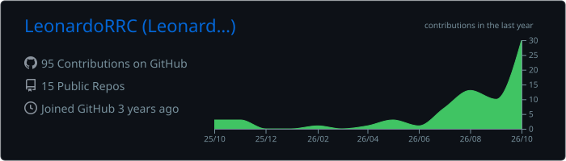
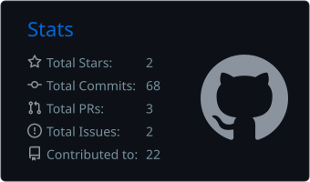
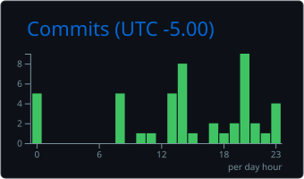
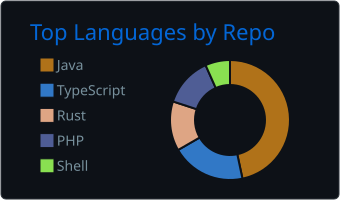
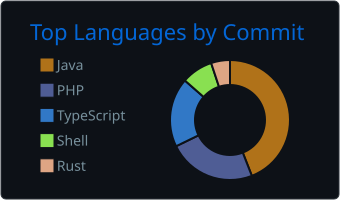

<!-- Header -->
<p align="center">
  
</p>

<p align="center">
  <a href="https://git.io/typing-svg">
    
  </a>
</p>

<p align="center">
  <a href="https://thequantum.uk/"></a>
  <a href="mailto:quantum@thequantum.uk"></a>
  
</p>

---

## 🧭 About me

```yaml
name:      Leonardo Reynoso
handle:    LeonardoRRC
studying:  Network and Communications Administration @ Cibertec (2025 – present)
previous:  Systems and Computer Engineering @ Senati (2021 – 2025, coursework completed)
focus:     [network engineering, linux server administration, cloud, devops]
building:  The Quantum Development — Pterodactyl addons, themes and self-hosted tooling
origin:    Minecraft plugin developer (Spigot / Bukkit)
open_to:   [internships, freelance, infrastructure collaborations]
```

> 2+ years of hands-on experience deploying and running servers, automating ops with scripts and containers, and keeping game & web infrastructure online.

---

## 🛠️ Tech stack

<p align="center">
  <br/>
  
</p>

<table align="center">
  <tr>
    <td valign="top" width="50%">

**🌐 Networking & Infra**
- Network design & administration
- Firewall & security configuration
- SSH · SFTP · FTP · DNS · DHCP
- Monitoring & troubleshooting

</td>
    <td valign="top" width="50%">

**🖥️ Servers & Virtualization**
- Linux (Debian, Ubuntu, Alpine) & Windows Server
- Proxmox · VMware · Docker & Compose
- Nginx · Apache · Cloudflare Tunnel
- Pterodactyl · Pelican panels

</td>
  </tr>
</table>

---

## 🚀 Featured projects

| Project | What it does | Stack |
|---|---|---|
| 🛡️ [**Cubethon**](https://github.com/LeonardoRRC/Cubethon) | VPN / proxy / hosting detection API by ASN, backed by the global BGP routing table |  |
| 🗄️ [**pterodactyl-supabase**](https://github.com/LeonardoRRC/pterodactyl-supabase) | Self-hosted Supabase in a single container for Pterodactyl, Pelican and Calagopus, with Cloudflare Tunnel |  |
| ✂️ [**server-splitter**](https://github.com/LeonardoRRC/server-splitter) | Split a Pterodactyl v2 server's memory, disk and CPU into sub-servers |  |
| 🎨 [**carbon-theme**](https://github.com/LeonardoRRC/carbon-theme) | Carbon theme for Pterodactyl v2 |  |
| 🧱 [**mcpanel-zimaos**](https://github.com/LeonardoRRC/mcpanel-zimaos) | Web panel for Minecraft servers on ZimaOS: console, files, Java 8–25 startup and playit.gg tunnels |  |
| 🧰 [**HyfeUtils**](https://github.com/LeonardoRRC/HyfeUtils) | Java utility API for Bukkit plugins, 1.8.8 to current versions |  |

<details>
<summary><b>More projects</b></summary>

| Project | What it does | Stack |
|---|---|---|
| [votifier-tester](https://github.com/LeonardoRRC/votifier-tester) | Send test votes to a server's Votifier from Pterodactyl v2 | TypeScript |
| [tiktok-lyrics-video](https://github.com/LeonardoRRC/tiktok-lyrics-video) | Karaoke-style synced lyric videos for TikTok / Shorts | Rust |
| [ProtectionStone](https://github.com/LeonardoRRC/ProtectionStone) | Region protection plugin for Minecraft | Java |
| [LimboAuth](https://github.com/LeonardoRRC/LimboAuth) · [LimboAPI](https://github.com/LeonardoRRC/LimboAPI) | Auth & limbo tooling for Velocity proxies | Java |

</details>

---

## 📊 GitHub stats

<!-- Cards are generated into this repo by .github/workflows/stats.yml -->
<p align="center">
  
</p>

<p align="center">
  
  
</p>

<p align="center">
  
  
</p>

<p align="center">
  
</p>

---

## ⚡ Recent activity

<!--START_SECTION:activity-->
1. 🚀 Published release [Carbon Theme 2.0.0](https://github.com/LeonardoRRC/carbon-theme/releases/tag/v2.0.0) in [LeonardoRRC/carbon-theme](https://github.com/LeonardoRRC/carbon-theme)
2. 🚀 Published release [1.1.0](https://github.com/LeonardoRRC/HyfeUtils/releases/tag/1.1.0) in [LeonardoRRC/HyfeUtils](https://github.com/LeonardoRRC/HyfeUtils)
<!--END_SECTION:activity-->

---

## 🐍 Contributions

<p align="center">
  <picture>
    <source media="(prefers-color-scheme: dark)" srcset="https://raw.githubusercontent.com/LeonardoRRC/LeonardoRRC/output/github-snake-dark.svg" />
    <source media="(prefers-color-scheme: light)" srcset="https://raw.githubusercontent.com/LeonardoRRC/LeonardoRRC/output/github-snake.svg" />
    
  </picture>
</p>

---

## 🤝 Let's collaborate

Open to internships, freelance work and collaborations in **network operations**, **DevOps** and **infrastructure**.
If you're working on something interesting, [send me an email](mailto:quantum@thequantum.uk) or check out [thequantum.uk](https://thequantum.uk/).

<p align="center">
  
</p>
